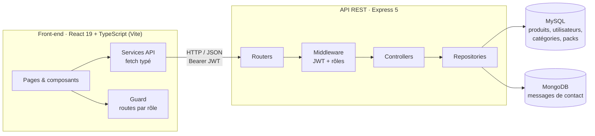
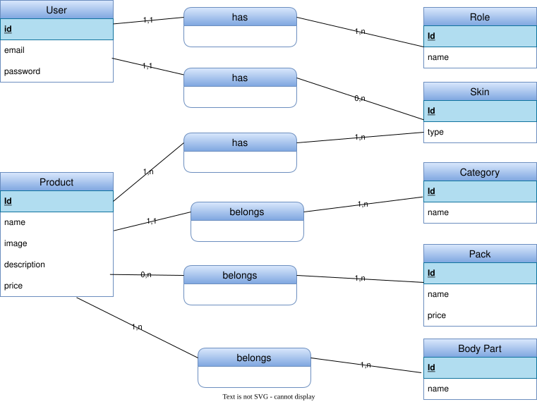
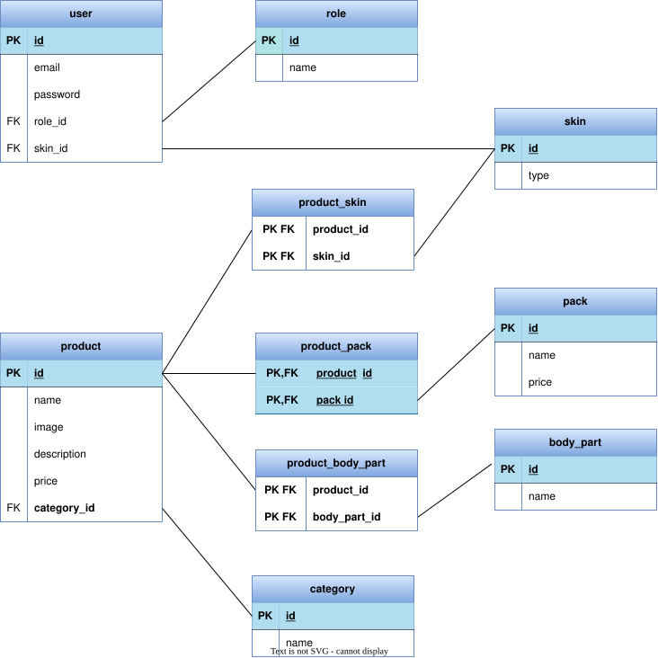
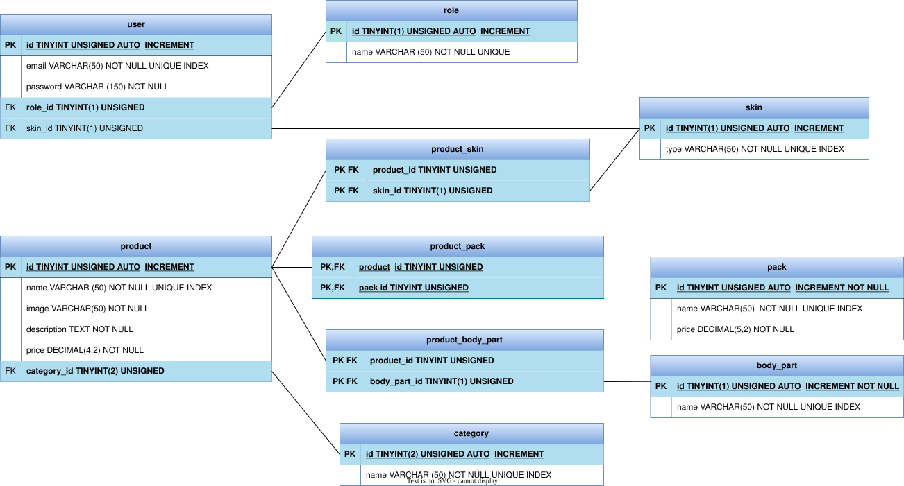

<div align="center">


# Secret de Hammam

**Boutique en ligne full-stack de soins orientaux, de la maquette Figma au déploiement conteneurisé.**

[](https://github.com/Hayat91800/Secret-de-Hammam/actions/workflows/ci.yaml)


*Projet présenté pour l'obtention du titre professionnel **Développeur Web et Web Mobile** (Simplon, 2025).*

</div>

---

## En bref

Secret de Hammam présente des produits de soin traditionnels (savon noir, rhassoul, huiles…) avec des **guides d'utilisation**, des **filtres par type de peau et zone du corps**, un **espace client** et un **back-office administrateur**.

J'ai mené le projet de bout en bout, seule :

- **Conception** : maquettes et charte graphique sur Figma, modélisation Merise (MCD → MLD → MPD)
- **Front-end** : React 19 + TypeScript, routage par rôle, formulaires validés, thème clair/sombre
- **API REST** : Express 5 en architecture *Router → Controller → Repository → Service*
- **Données** : MySQL pour le cœur métier, MongoDB pour les messages de contact
- **Sécurité** : mots de passe hachés avec Argon2, authentification JWT, contrôle d'accès par rôle
- **Qualité** : tests d'intégration de l'API (Vitest + Supertest), CI GitHub Actions, linter Biome
- **Environnement** : Docker Compose et Dev Containers VS Code, reproductible sur n'importe quel poste

<div align="center">

</div>

<!--
  Captures d'écran à ajouter dans docs/screenshots/ :
    
-->

---

## Fonctionnalités

| Visiteur | Client connecté | Administrateur |
|---|---|---|
| Accueil avec carrousel et produits mis en avant | Inscription / connexion | Tableau de bord dédié |
| Catalogue de produits | Tableau de bord profil | **CRUD complet des produits** (ajout, modification, suppression) |
| Fiche produit avec guide de soin | Déconnexion | Upload d'images produit (Multer) |
| Formulaire de contact (stocké dans MongoDB) | | Routes protégées par JWT et rôle `admin` |
| Pages À propos et Mentions légales, SEO par page | | |
| Thème clair / sombre | | |

---

## Architecture



Chaque couche a une seule responsabilité : le **router** déclare les routes, le **middleware** vérifie le jeton et le rôle, le **controller** gère la requête HTTP et le **repository** isole les requêtes SQL (requêtes préparées contre l'injection SQL). Les modèles TypeScript dans `code/models/` sont **partagés entre le front et l'API**, ce qui garantit des types identiques des deux côtés.

```
code/
├── models/          # Types partagés front ↔ back (Product, User, Category…)
├── server/
│   ├── router/      # Déclaration des routes
│   ├── middleware/  # Autorisation JWT + rôles
│   ├── controller/  # Logique HTTP
│   ├── repository/  # Accès aux données (SQL / MongoDB)
│   └── service/     # Connexions MySQL, MongoDB, fichiers
├── src/
│   ├── pages/       # public / user / admin
│   ├── layouts/     # Un layout par espace
│   ├── components/  # Composants réutilisables
│   ├── services/    # Appels à l'API
│   └── validators/  # Schémas de validation des formulaires
├── mysql/           # Schéma + jeux de données (dev et test)
├── merise/          # MCD, MLD, MPD
└── tests/           # Tests d'intégration de l'API
```

---

## Stack technique

| Domaine | Outils |
|---|---|
| Front-end | React 19, TypeScript, Vite, React Router 7, React Hook Form + Zod, CSS Modules |
| Back-end | Node.js, Express 5, Multer |
| Bases de données | MySQL 9 (relationnel), MongoDB 8 (documents) |
| Sécurité | Argon2, JWT (jose), CORS configuré par variables d'environnement |
| Tests & qualité | Vitest, Supertest, couverture V8, Biome |
| DevOps | Docker Compose, Dev Containers, GitHub Actions |
| Conception | Figma, Merise (draw.io) |

---

## API REST

| Méthode | Route | Accès | Description |
|---|---|---|---|
| `POST` | `/api/register` | Public | Créer un compte (mot de passe haché Argon2) |
| `POST` | `/api/login` | Public | Se connecter et recevoir un JWT |
| `GET` | `/api/product` | Public | Lister les produits |
| `GET` | `/api/product/:id` | Public | Détail d'un produit |
| `POST` | `/api/product` | **Admin** | Ajouter un produit (multipart, image) |
| `PUT` | `/api/product` | **Admin** | Modifier un produit |
| `DELETE` | `/api/product` | **Admin** | Supprimer un produit |
| `GET` | `/api/category` · `/api/skin` · `/api/body_part` · `/api/pack` | Public | Référentiels (liste et `/:id`) |
| `POST` | `/api/contact` | Public | Envoyer un message (MongoDB) |

Des collections de requêtes prêtes à l'emploi sont disponibles dans [`code/__flashpost/`](code/__flashpost/).

---

## Modélisation des données

| MCD | MLD | MPD |
|---|---|---|
|  |  |  |

Relations principales : un produit appartient à une catégorie et peut être associé à plusieurs **types de peau**, **zones du corps** et **packs** (tables de jointure `product_skin`, `product_body_part`, `product_pack`).

---

## Lancer le projet

**Prérequis** : [Docker](https://www.docker.com/) et [Git](https://git-scm.com/). VS Code avec l'extension *Dev Containers* est recommandé.

```bash
# 1. Cloner le dépôt
git clone https://github.com/Hayat91800/Secret-de-Hammam.git
cd Secret-de-Hammam

# 2. Créer le fichier d'environnement
cp code/.env.example code/.env.development

# 3. Démarrer les conteneurs (Node, MySQL, MongoDB)
docker compose -f docker-compose.dev.yaml up -d

# 4. Créer la base MySQL et la remplir
docker compose -f docker-compose.dev.yaml exec mysql \
  sh -c "mysql -uroot -proot < secrets_de_hammam.dev.sql && mysql -uroot -proot < contenu-ia.sql"

# 5. Installer les dépendances
docker compose -f docker-compose.dev.yaml exec app npm ci

# 6. Lancer l'API puis le front (dans deux terminaux)
docker compose -f docker-compose.dev.yaml exec app npm run server
docker compose -f docker-compose.dev.yaml exec app npm run dev
```

| Service | URL |
|---|---|
| Site web | http://localhost:5173 |
| API | http://localhost:3000/api |

> Avec VS Code : *Dev Containers : Reopen in Container* ouvre directement un terminal dans le conteneur `app`, les commandes `npm` s'exécutent alors sans le préfixe `docker compose exec`.

---

## Tests

```bash
npm run test            # tests d'intégration de l'API
npm run test:coverage   # rapport de couverture (code/tests/coverage)
```

Les tests utilisent une base MySQL dédiée (`secretsDeHammam_test`) et le fichier `.env.test`. Ils sont exécutés automatiquement par **GitHub Actions** à chaque push sur `master` : installation, build du front, création de la base de test, puis exécution des tests.

---

## Ce que ce projet m'a appris, et ce que j'emporte vers iOS

> **Ce projet est entièrement web (React / Node.js) et ne contient pas de partie iOS.** Le tableau ci-dessous montre comment les compétences acquises ici se transposent en développement iOS.

Je poursuis aujourd'hui en **Concepteur Développeur d'Applications – Swift** (Simplon × Apple). Les fondations posées ici se retrouvent directement en développement iOS :

| Dans Secret de Hammam | En Swift / iOS |
|---|---|
| Architecture en couches (router, controller, repository, service) | MVVM, séparation View / ViewModel / Service / Repository |
| Services API typés avec `fetch` + `async/await` | `URLSession` + `async/await`, modèles `Codable` |
| Types TypeScript partagés entre front et API | Structs `Codable` alignés sur le contrat de l'API |
| JWT envoyé en `Authorization: Bearer` | Jeton stocké dans le Keychain, injecté dans les requêtes |
| Routes protégées par rôle (Guard) | Navigation conditionnelle (`NavigationStack`) selon l'état d'authentification |
| Tests d'intégration Vitest + Supertest | XCTest / Swift Testing |
| Conception Figma et charte graphique | Interfaces SwiftUI conformes aux Human Interface Guidelines |
| API REST Express | Back-end Swift avec **Vapor** (en cours dans ma formation) |

### Pistes d'amélioration identifiées

- Ne plus exposer la clé de signature JWT au front : vérification du jeton côté serveur uniquement, via une route `/api/me`
- Passer l'identifiant dans l'URL pour `PUT` et `DELETE` (`/api/product/:id`) afin de respecter pleinement les conventions REST
- Étendre la couverture de tests aux routes d'authentification et de contact
- À terme, développer une application **iOS SwiftUI** qui consommerait cette même API (non réalisée à ce jour)

---

## Documentation

- [Dossier de projet de certification (PDF)](Docs_projet/mon_projet_certification2.pdf)

## Autrice

**Hayat Zakhoukh**, développeuse en reconversion, en formation CDA Swift (Simplon × Apple).
Je recherche une **alternance de 12 mois en développement iOS / Swift à partir de janvier 2027**.

[GitHub](https://github.com/Hayat91800)<!-- · [LinkedIn](https://www.linkedin.com/in/VOTRE-PROFIL) -->
